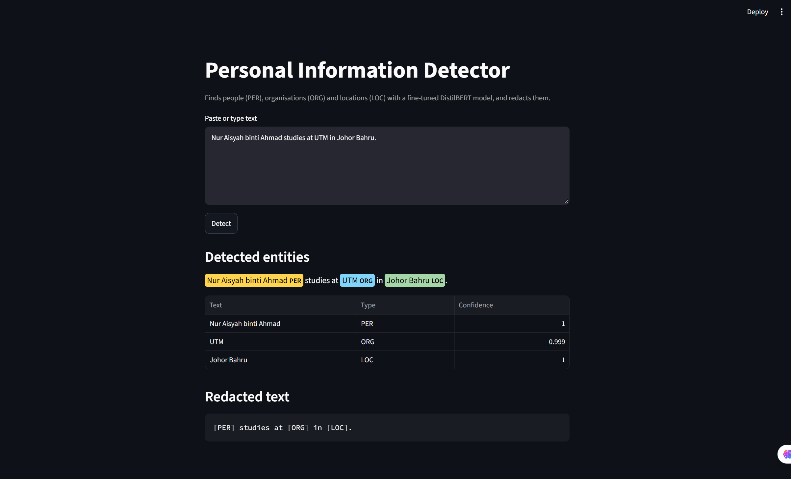

# Personal Information Detection in Text (NER)

AiROST Internship 2026/27 · ML/AI track · Problem 2: Personal Information Detection in Text

A fine-tuned DistilBERT model that reads raw text, finds **people (PER)**, **organisations (ORG)** and **locations (LOC)**, and returns a **redacted version** of the text. It is trained on the public CoNLL-2003 dataset plus a small self-written Malaysian dataset (Malay, English and mixed sentences).

> Example: `Nur Aisyah binti Ahmad studies at UTM in Johor Bahru.` → `[PER] studies at [ORG] in [LOC].`



## Features

- Trained model that detects PER, ORG and LOC (the model does the prediction itself; no external API or ready-made NER pipeline is used)
- Streamlit app: paste text or upload a file, see highlighted entities with confidence scores, copy or download the redacted text
- Bonus 1: redacted output (each entity replaced by its type label)
- Bonus 2: small labeled Malaysian dataset (371 training sentences, 90 development test sentences and 41 fresh test sentences), used for training and evaluation
- Bonus 3: upload .txt or .pdf files (text extraction with pypdf; the detection itself is done by my own model)
- Fine-tuning process documented step by step in the notebooks
- The Hugging Face pipeline function is used only as a wrapper to run my own fine-tuned model; the predictions come from the model I trained, not from a pre-built NER model.

## Results

The final model (Run 4) was continued from a CoNLL-2003 baseline and trained on 4,000 CoNLL sentences mixed with the Malaysian sentences (repeated 10 times). Scores are entity-level F1 (`seqeval`).

| Test set | Baseline | Final model (Run 4) |
|---|---|---|
| Fresh test set (41 sentences, 72 new entities), F1 | 0.562 | **0.874** |
| Malaysian development test set (90 sentences), F1 | 0.778 | 0.954 |
| Entities never seen in training (101), found exactly | 77 (76.2%) | 94 (93.1%) |
| Strict set (17 sentences whose entities are all unseen), F1 | 0.563 | 0.806 |
| CoNLL-2003 test, F1 | 0.886 | 0.884 |

- **The fresh test set is the most reliable number** (precision 0.857, recall 0.892). It uses names, places and organisations that are not in the training data, and it was never used for training or tuning.
- The 90-sentence set is a **development set**: I chose training sentences after inspecting its errors, so its score is optimistic.
- CoNLL-2003 F1 stayed the same, so the Malaysian training did not make the model forget international text.
- Scores vary by a few points between runs (for example, deleting one training line moved the fresh-test F1 from 0.899 to 0.874). Treat differences below about 0.03 as noise.

### How the runs improved

| Run | What changed | Malaysian training sentences | Dev test F1 | CoNLL-2003 F1 |
|---|---|---:|---:|---:|
| 1 (baseline) | DistilBERT fine-tuned on CoNLL-2003 only | 0 | 0.778 | 0.886 |
| 2 | Added Malaysian sentences | 203 | 0.959 | 0.888 |
| 3 | Added Malaysian brand names and sentences with no entities | 242 | 0.965 | 0.888 |
| 4 (final) | Added title-cased headings, place and brand lists, language names, "Malaysia" in Malay phrases | 371 | 0.954 | 0.884 |

Run 4's short-sentence score is slightly below Run 3's, which is within run-to-run noise. Its benefit shows on article-style text (below). The details of Run 3 and Run 4 are in `02_malaysian.ipynb`.

### Article-style text

I also ran the app on a 26 KB bilingual (English and Malay) article corpus with about 600 tagged entity mentions (the corpus is not included in this repository) and compared the redacted output with the original by hand. These are counts of errors I could list, not an accuracy score:

| Check | First app version | Run 3 | Run 4 (final) |
|---|---:|---:|---:|
| Spans tagged | 710 | 678 | 613 |
| Fragments and non-entity words tagged | 130 | 40 | 8 |
| Known places given the wrong type | 75 | 37 | 10 |
| PER spans that are not people | 46 | 67 | 7 |
| Tags on all-caps heading lines | 19 | 9 | 0 |
| Wrong spans by my count (lower bound) | 29% | 11% | 3% |

The true error rate is probably around 5%. Because I added training data after inspecting this corpus's errors, it is a development set and these numbers are optimistic.

### Before and after on example sentences

| Sentence | Baseline | Final model |
|---|---|---|
| `Giant dan Tesco menawarkan diskaun besar.` | Tesco → PER, Giant missed | Giant → ORG, Tesco → ORG |
| `Sila hantar borang sebelum hari Jumaat.` | Sila → PER, Jumaat → PER | no entities |

## Repository contents

```
.
├── 01_baseline.ipynb        # Fine-tune DistilBERT on CoNLL-2003 (Run 1)
├── 02_malaysian.ipynb       # Malaysian dataset, retraining, evaluation (Runs 2 and 4)
├── app.py                   # Streamlit app (detection + redaction + file upload)
├── requirements.txt         # Python dependencies
├── data/
│   ├── malaysian_train.txt       # 371 labeled training sentences
│   ├── malaysian_test.txt        # 90 labeled test sentences
│   └── malaysian_test_fresh.txt  # 41 labeled fresh test sentences
└── screenshots/             # App screenshots
```

## Getting the code (GitHub basics)

1. Install [Git](https://git-scm.com/downloads) and Python 3.10 or newer.
2. Clone the repository and enter the folder:
   ```bash
   git clone https://github.com/Yii0909/ner-pii-detection.git
   cd ner-pii-detection
   ```
3. (Recommended) create a virtual environment:
   ```bash
   python -m venv venv
   venv\Scripts\activate        # Windows
   source venv/bin/activate     # macOS / Linux
   ```
4. Install the dependencies:
   ```bash
   pip install -r requirements.txt
   ```
5. New to GitHub? This tutorial from the problem statement explains the basics: https://youtu.be/i_23KUAEtUM

## Run the app

The trained model is hosted on Hugging Face at [`Yxian909/ner-malaysian`](https://huggingface.co/Yxian909/ner-malaysian), so you do not need to train anything to try it.

```bash
py -m streamlit run app.py
```

A browser tab opens at `http://localhost:8501`. The first run downloads the model (about 260 MB), so you need an internet connection.

- **Type or paste text** tab: write or paste text, click **Detect**, and read the highlighted entities and the redacted text.
- **Upload a file** tab: choose a `.txt` or `.pdf` file and click **Detect in file**. Files are processed in memory and are not saved. Long files are cut at 100,000 characters (and 30 PDF pages).
- Click **Download redacted text** to save the result.

To use a local model folder instead, change `MODEL_ID` at the top of `app.py`.

## Reproduce the training

Both notebooks were run on Google Colab with a free T4 GPU (Runtime → Change runtime type → T4 GPU).

1. Open `02_malaysian.ipynb` in Colab (T4 GPU) and run all cells. It loads the baseline model from Hugging Face
   ([`Yxian909/ner-baseline`](https://huggingface.co/Yxian909/ner-baseline), trained in `01_baseline.ipynb`),
   evaluates it (before), retrains on the Malaysian data (after), and runs the evaluations above.
2. To retrain the baseline yourself, run `01_baseline.ipynb` (about 2 minutes on a T4 GPU).
3. The cells that upload models to Hugging Face are switched off by default (`PUSH_TO_HUB = False`).
   Turn them on only if you want to upload your own copy, and use your own token and repo names.

A seed (42) is set, so results should be very close to the numbers above on the same library versions (see `requirements.txt`), although GPU runs can differ by a point or two.

### Method

- **Model:** `distilbert-base-cased` with a token-classification head (labels from CoNLL-2003; only PER, ORG and LOC are used in the app).
- **Baseline:** 3 epochs, learning rate 2e-5, batch size 16, weight decay 0.01 on CoNLL-2003. Labels are aligned to the first sub-word of each word.
- **Malaysian training:** the baseline is trained further for 3 epochs (same settings) on 4,000 random CoNLL sentences plus the Malaysian training sentences repeated 10 times. The CoNLL sentences stop the model forgetting international text.
- **Evaluation:** entity-level precision, recall and F1 with `seqeval`.
- **Redaction:** each detected entity is replaced with its type label, and neighbouring entities of the same type are merged.
- **Redaction pipeline around the model:** long text is split into sentences (the model was trained on single sentences),
  ALL-CAPS heading lines are converted to title case for the model only (offsets are unchanged), and neighbouring
  fragments such as "Pulau" + "Pinang" are merged into one entity. The predictions themselves always come from my own model.

## Malaysian dataset

- Sentences are written in the format `[entity text](TYPE)`, with TYPE as PER, ORG or LOC. Titles such as *Dr.*, *Encik* and *Puan* stay outside the brackets.
- They are in English, Malay and mixed language, and use made-up names or well-known public figures, places and organisations. Events, programmes, language names and dates are not labeled.
- Some sentences have no entities on purpose, so the model learns not to tag every capitalised word.
- **AI assistance:** I wrote part of the sentences myself. Many of the training sentences, and the whole 41-sentence fresh test set, were drafted with help from Claude (Anthropic), and I reviewed and corrected the labels.
- No sentence appears in more than one of the training, development and fresh sets. Some common entities (for example "Kuching") appear in both the training and development sets, which is why the fresh set and the strict-set result are the more realistic checks (only 1 of the 72 fresh-set entities, "Sarawak", also appears in training).

## Limitations

- The Malaysian dataset is small, and its sentences are in a similar style to each other, so real-world accuracy is likely lower than the development-set scores. The fresh test set (F1 0.874) is a better estimate, but it is small and was also drafted with AI help.
- The development set and the article corpus were used to decide what training sentences to add, so their scores are optimistic.
- Remaining misses on unseen entities include long Malay organisation names (for example "Majlis Daerah Mukah", "Lembaga Hasil Dalam Negeri"), some titles and name formats ("a/p"), and some single-word names.
- Brand names that resemble surnames or place names (for example "Ramly", "Mydin") are sometimes tagged as people.
- "Malaysia" inside Malay noun phrases (for example "pemain badminton Malaysia") is sometimes tagged as an organisation.
- A few entities are still missed at the start of sentences, such as "Penang".
- Capitalised unfamiliar words can be tagged as names, and the confidence score is not reliable (wrong labels can show 0.99).
- PDFs must contain real text. Scanned PDFs (images) need OCR, which is not supported.
- Only people, organisations and locations are detected. Other personal information such as phone numbers, emails and ID numbers is not detected.
- Do not rely on this tool alone to remove personal data from real documents.

## Possible future work

- Test on sentences written by other people, and grow the Malaysian dataset
- A from-scratch model (for example BiLSTM-CRF) to compare with the fine-tuned model
- OCR for scanned PDFs, and detection of other personal information (phone numbers, emails, ID numbers)

## Acknowledgements

- [CoNLL-2003](https://aclanthology.org/W03-0419/) (Tjong Kim Sang and De Meulder, 2003), loaded from the Hugging Face dataset `tomaarsen/conll2003`
- [DistilBERT](https://huggingface.co/distilbert-base-cased) (Sanh et al., 2019) via Hugging Face Transformers
- [Streamlit](https://streamlit.io/), [pypdf](https://pypdf.readthedocs.io/) and [seqeval](https://github.com/chakki-works/seqeval)
- Claude (Anthropic), used to help draft some sentences and review code
- AiROST for the problem statement
